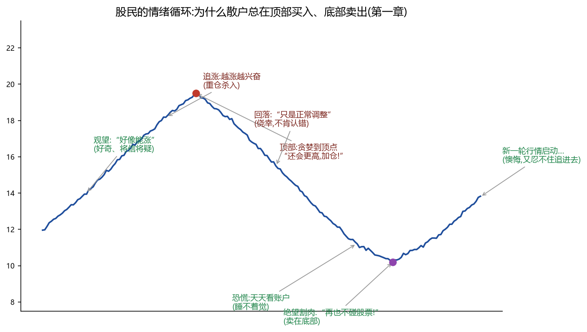

# 第一章 炒股的挑战(章节详解)

> **本章回答一个问题:为什么绝大多数股民都亏钱?**
> 作者给出的答案不是"知识不够",而是——**人性**。这一章是全书的地基:先认清自己,再谈技术。

---

## 1.1 华尔街的第一课:炒股是与人性作战

书开篇引用了一句华尔街名言,也是全书的基调:

> **"股票市场是有经验的人获得很多金钱、有金钱的人获得很多经验的地方。"**

这句话残酷但诚实,它包含三层意思:

1. **经验值钱**:老手靠多年积累的判断力赚钱;
2. **学费昂贵**:新手几乎必然要"用钱换经验";
3. **循环残酷**:等你攒够了经验,可能已经交完了学费(本金亏光)。

作者进一步指出:炒股的技术**来自经验的积累**,而这个积累过程是艰难且痛苦的,因为它**处处与人性相冲突**——该止损时人性让你抱侥幸,该持有时人性让你怕到失眠,该空仓时人性让你手痒。所以:

> **炒股最难的不是战胜市场,而是战胜自己。**

---

## 1.2 股市是一个"特殊的赌局"

作者不回避这个比喻:**股市确实像赌场**,都有不确定性、都靠概率。但它有三个关键的不同,而这些不同恰恰是聪明人能够赢的原因:

| 对比项 | 普通赌局(如轮盘) | 股市 |
|---|---|---|
| **能不能不下注** | 不能,坐上桌就得玩 | **可以空仓等待**,一直等不到好机会就一直不玩 |
| **能不能中途离场** | 一局定了才能走 | **随时可以止损离场**,把损失锁在很小 |
| **赔率** | 固定且对你不利(赌场抽水) | **自己研究可以判断**:胜算大时赔率往往也大 |

**赌场老板为什么稳赚?** 不是每局都赢,而是每局都有一点微弱的概率优势,重复千次万次,优势必然兑现。这就是**期望值**的力量。

**股市赢家同理**:你不需要每次都对,你只需要建立自己的期望值优势——

- 胜算小的时候:**不下注**(空仓也是一种操作);
- 胜算大、赔率好的时候:**才出手,且下重一点的注**。

> 所以作者说:会炒股的人,**大部分时间在等,小部分时间在打**。频繁进出的人,本质是把每一局都当成胜算相同的局来玩,恰恰暴露了他没有概率思维。

---

## 1.3 一般股民何以失败:六大人性弱点(本章核心)

作者总结了让大多数股民亏钱的六大人性弱点。**每一条都要对照自己**——这一节与其说在讲市场,不如说在照镜子。

上图是散户的标准心理轨迹:观望→追涨→贪婪→侥幸→恐慌→绝望割肉→懊悔再追……**一轮轮循环,一轮轮亏损**。下面六条弱点就是驱动这个循环的引擎。

### 弱点一:讨厌风险(最致命的一条)

- **表现**:账面亏损时,人本能地**拒绝把亏损"变成现实"**——不卖就不算亏。于是小亏拖成大亏;而账面盈利时,又怕利润飞走,急急忙忙落袋。
- **结果**:**赚小钱,亏大钱**——正好和成功所需的方法(亏小钱、赚大钱)完全相反。
- **书中的场景**:股票从 20 元跌到 18 元,你对自己说"反弹就卖";跌到 16 元,你说"都跌这么多了,还能跌到哪";跌到 12 元,你干脆不看了。最后在 9 元,你终于崩溃割肉——**卖在最低点**,因为那时恐惧压倒了一切。
- **对策**:**止损是成本,不是损失**。做生意要进货成本,炒股的"进货成本"就是偶尔止损掉的小钱。接受它,你才能活下来。

### 弱点二:急功近利

- **表现**:想一夜暴富,于是满仓一只股、频繁短线、听消息博重组。
- **结果**:手续费和滑点不断磨损本金;而且**满仓一次大错,就足以清零半年利润**。
- **对策**:把预期降到"每年稳定赚钱"的量级。**市场里活得久比跑得快重要一百倍。**

### 弱点三:好自以为是

- **表现**:买了股票就只看得见利好;股价跌了,不检查"我是不是错了",而是拼命找理由说服自己"主力在洗盘""基本面没变"。
- **结果**:把理智降级为"为自己辩护的律师",小亏拖成大亏。
- **书中提醒**:**市场永远是对的,错的只能是你。** 股价跌了,说明市场在告诉你:你的判断有问题。听市场的,别听自己的。

### 弱点四:好跟风

- **表现**:听朋友、听股评、听"内部消息"就敢下重注;别人买什么自己买什么。
- **结果**:**你听到消息时,消息早已反映在股价里**;你进场,正是人家出货的时候。
- **书中调查**:华尔街的调查显示,一般人买入股票的最主要原因是"**这只股票在涨**",卖出的最主要原因是"**这只股票在跌**"——完全是情绪和羊群驱动,与价值判断无关。
- **对策**:每一笔买卖,必须能自己说出理由。说不出理由的交易,就是赌博。

### 弱点五:因循守旧

- **表现**:死抱亏损股"等回本",哪怕基本面早已恶化;或者坚持一套早已失效的老方法。
- **结果**:"等回本"的潜台词是"我知道错了,但我就是不改"——资金被钉死在烂股上,错过了无数机会。
- **对策**:**股票不知道你的买入价**。它跌,就是该考虑卖;它涨,才是该考虑持有。你的成本价对市场毫无意义。

### 弱点六:报复心理

- **表现**:刚被止损,又羞又怒,立刻杀回市场"把钱赚回来",仓位比上次更大。
- **结果**:情绪化交易接二连三,越亏越赌,越赌越亏——赌徒的毁灭路径。
- **对策**:**连续亏损时,减仓、甚至离场休息**。市场天天开门,机会永远有,先修好心态再说。

### 六大弱点的共同根源:贪与怕

作者把千万人性弱点归结为两种根本情绪:

| 情绪 | 让你做的事 | 后果 |
|---|---|---|
| **贪** | 追高、满仓、盈利不肯走、亏了不肯砍 | 买在顶、套在顶 |
| **怕** | 不敢买强势股、盈利早早落袋、亏损死扛不敢面对 | 卖在底、拿不住好股 |

> 注意:贪和怕经常**同时**出现在同一个人身上——对利润"贪",对止损"怕"。这就是为什么多数人"赚小亏大"。**炒股的过程,就是训练自己在该贪的地方贪(让利润奔跑)、在该怕的地方怕(坚决止损)。**

---

## 1.4 炒股成功的基本要诀

认清人性弱点后,作者给出四条基本要诀,作为后面所有技术方法的出发点:

### 要诀一:保本第一

> 巴菲特名言:"第一条是保住本金,第二条是保住本金,第三条是记住前两条。"

- 本金是你在牌桌上的筹码,**筹码没了,再好的机会也与你无关**。
- 数学事实:亏 50%,需要赚 100% 才回本;亏 70%,需要赚 233%。**亏损是不对称的,所以保本永远优先于赚钱。**
- 落实到操作:每笔交易进场前,先问"我最多会亏多少",而不是"我能赚多少"。

### 要诀二:快速止损

- 止损要**快、狠、不找理由**。犹豫一秒,侥幸就会占领大脑。
- 止损点必须在**买入前**定好(第三章会讲怎么定),而不是套住了再想。

### 要诀三:别一次下注太多

- 永远保留后备资金。满仓意味着失去纠错能力——错了只能干瞪眼。
- 分批进场,错了损失小,对了还有钱加码(具体方法见第三章资金管理)。

### 要诀四:不断盈利靠的是"知识 + 经验 + 心态"

- **知识**:可以通过读书快速获得(本书第二、三章就是);
- **经验**:只能用时间和真金白银慢慢换,没有捷径;
- **心态**:在一次次实战中修炼,是最后拉开差距的东西。
- 三者的关系:**知识告诉你该怎么做,经验告诉你做得成什么样,心态决定你做不做得到。**

### 新手的正确起步:用小钱换经验

作者给新手的忠告:**一开始就用小钱玩,把学费控制在可以承受的范围内。** 用亏得起的钱,去买昂贵的经验,是股市里最划算的一笔交易。等你能稳定地不亏大钱了,再逐步加大资金。

---

## 1.5 本章自测(检验是否真的理解)

1. 股市和普通赌局的三个不同是什么?这些不同给了理性玩家什么优势?
2. "赚小钱、亏大钱"对应哪条人性弱点?它的心理机制是什么?
3. 为什么说"不卖就不算亏"是自欺欺人?你的成本价对市场意味着什么?
4. 华尔街调查显示散户"为什么买、为什么卖"?这说明了什么?
5. 亏 50% 要赚多少才回本?这说明保本为什么优先?
6. 连续亏损时,正确做法是什么?错误做法(报复性交易)的心理根源是什么?

---

## 本章金句

- 股票市场是有经验的人获得很多金钱、有金钱的人获得更多经验的地方。
- 炒股最难的不是战胜市场,而是战胜自己。
- 股价跌了,市场就是在告诉你:你错了。
- 股票不知道你的买入价。
- 止损是生意的成本,不是损失。

---

**下一章**:认识了人性弱点,接下来需要知识武装——[第二章 股票分析的基本知识](02-第2章-股票分析的基本知识.md):基本面怎么选股、技术面怎么择时、华尔街家训怎么保命。

*导航:[全书知识点速读](全书知识点速读.md) | [下一章 →](02-第2章-股票分析的基本知识.md)*
