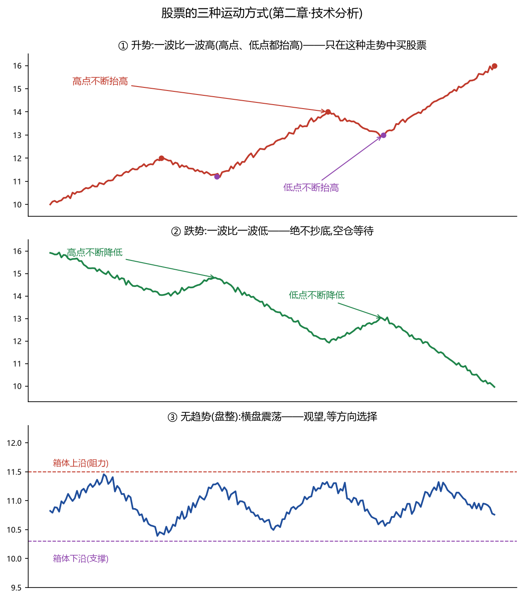
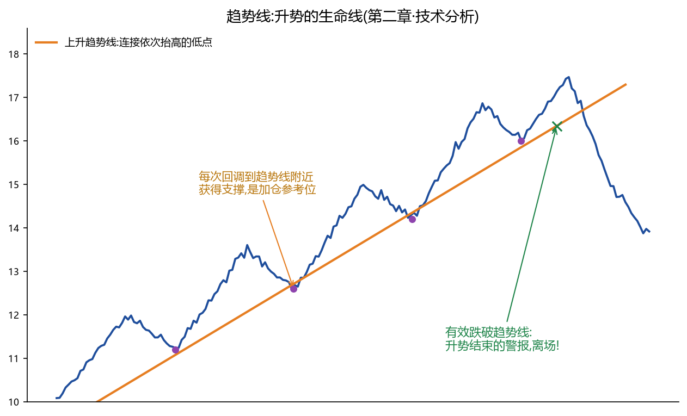
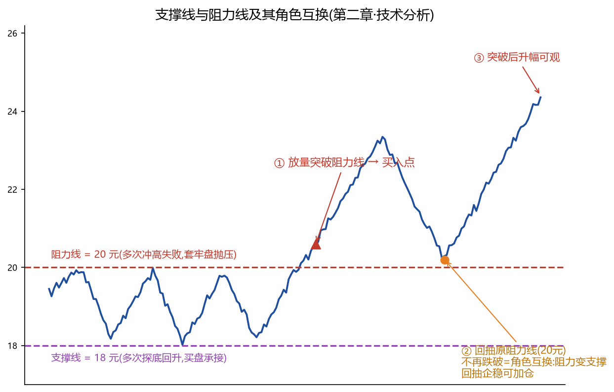
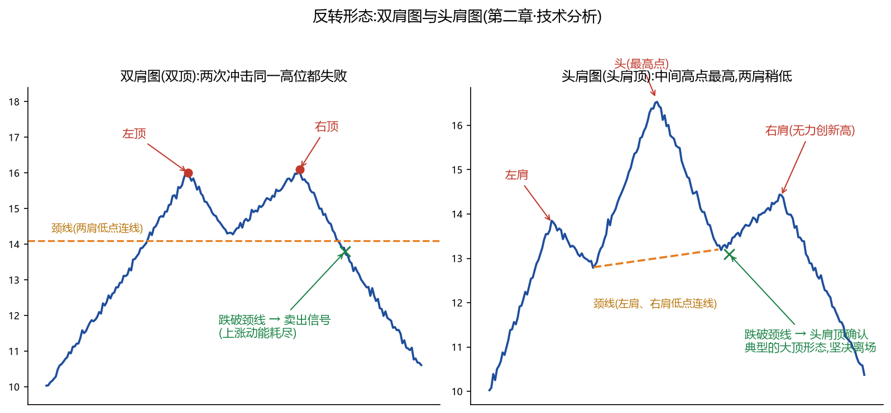
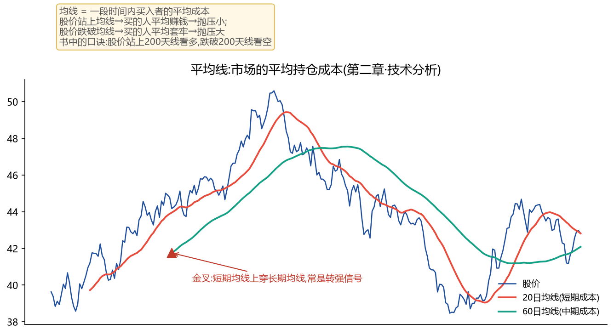
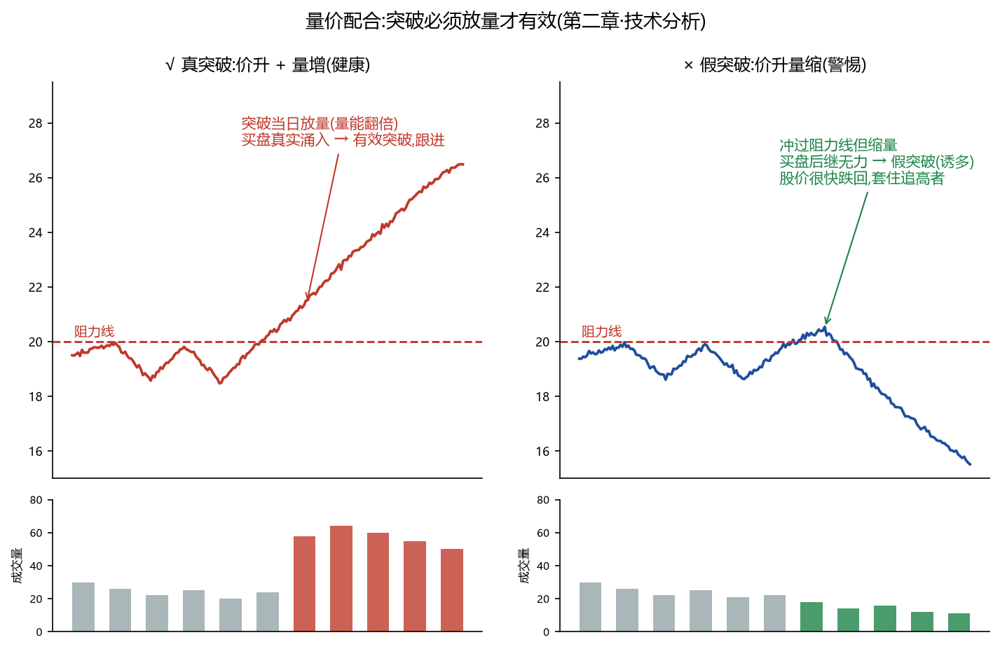

# 第二章 股票分析的基本知识(章节详解)

> **本章回答两个问题:买什么股票(基本分析)?什么时候买卖(技术分析)?**
> 最后附上华尔街老炒手的"家训"——每一条都是用血汗钱换来的纪律。

---

## 2.1 基本分析:这家公司值不值得买

### 核心信念

> **长期而言,股票的价格决定于公司的固定资产及其盈利能力。**

任何影响固定资产和盈利能力的因素,都在基本分析的考虑范围之内。基本分析回答的是"**这家公司值多少钱**",它决定你**买什么**;至于"什么时候买",交给技术分析(2.2 节)。

### 2.1.1 大环境:宏观 8 因素(了解即可,别沉迷)

| 因素 | 传导机制 | 对股价 |
|---|---|---|
| **利率** | 利率升 → 钱存银行更划算,股市资金流出 + 企业借贷成本增加 | 利空 |
| **税收** | 企业税增加 → 实际盈利减少 | 利空 |
| **汇率** | 本币升值 → 出口变难、营业额下降(机制极复杂,通常是国际政治经济角力的结果) | 多为利空 |
| **银根松紧** | 银根松 → 市场游资多;银根紧 → 游资被抽走 | 松利好、紧利空 |
| **经济周期** | 商品短缺 → 厂家利润高 → 股价升;一窝蜂投资后生产过剩 → 减价亏损 → 股价跌 | 周期波动 |
| **通货膨胀** | 政府为压通胀而加息 → 主要利空 | 利空 |
| **政治环境** | 动乱、战争、政权频繁更迭 → 经济混乱 | 利空 |
| **产业政策** | 政府扶持(税收减免、融资便利) | 利好 |

> **彼得·林奇:"我每年花在经济大势上的分析时间不超出十五分钟。"**
> 作者的态度:大环境是谈天的好材料,**炒股的实用性不大**——它太复杂、传导太慢、且人人皆知的信息早已反映在股价里。精力应放在小环境上。

### 2.1.2 小环境:公司 5 因素(选股的主战场)

| 因素 | 要点 |
|---|---|
| **营业收入** | 有潜力的公司营收必须有快速增长的势头(去年 1 亿、今年 2 亿、明年预计 4 亿)——这样的公司常提供股价短期翻几倍的机会 |
| **盈利** | 做很多生意但不赚钱的公司没有价值;盈利是衡量经营好坏的核心标准 |
| **固定资产** | 若公司市值 10 亿、固定资产 15 亿,说明市价没反映公司价值,股价可能偏低 |
| **同类公司对比** | 同行业公司有相似的经济周期和股价波动,互为参照系 |
| **品牌价值** | 有人估算"可口可乐"这个名字值 500 亿美元;过硬的品牌对股价影响深远 |

> ⚠️ **会计游戏警告**:看财报必须懂一点会计常识,且要留意水分——**销售收入确认方式、固定资产折旧方法**等都可能被"做"出来。数字漂亮 ≠ 公司好。

### 2.1.3 推动股价上涨的三大因素(重点)

虽然引起股价增长的因素很多,但**最重要的是盈利及盈利增长**。

**① 盈利的增长(核心)**

- 关键不是盈利的绝对值,而是**增长的速度和加速度**;
- **基数要合理**:每股从 1 分涨到 2 分是 100% 增长,但没有意义;从 5 角涨到 1 元的 100% 增长才让市场眼睛发亮;
- **必须有销售收入同步支撑**:营收不增、利润增,多半是玩会计游戏;
- **警惕背离**:营收翻倍(1 亿→2 亿)而盈利只增 20%(5 角→6 角),要查清楚——很可能竞争加剧、被迫削价求售;
- **最刺激市场的是加速增长**:增长从 25% 提速到 40%、50%,通常铺好了股价成倍上翻的路;
- **PE(成本收益比率)的误区**:新手爱用 PE 判断贵贱,作者直言"从根本上来说对,但炒股上实用性不大"——微软上市初期 PE 超 100,13 年涨了百倍。**高增长可以消化高 PE;低 PE 却可能是陷阱。**(PE 与 PEG 的详细讨论见同目录[成本收益比率_PE_介绍.md](成本收益比率_PE_介绍.md))

**② 新产品 / 新模式(爆发催化剂)**

新产品提供了盈利快速增长的可能,而且不限于实物——新生意概念、新推销手法、新管理方式都算:

| 案例 | 新在何处 | 涨幅 |
|---|---|---|
| 新态公司(1963) | 口服避孕药 | 6 个月翻 5 倍 |
| 王安电脑(1978-1980) | 新型文字处理机 | 2 年 13 倍 |
| 麦当劳(1967-1971) | 快餐连锁概念 | 4 年 11 倍 |

**③ 公司回购自身股票(信心信号)**

- 公司认为股价没反映公司价值时,才会用真金白银回购——**对自身投信任票**;
- 回购使流通股减少 → 相同盈利下每股盈利上升 → 起到降低 PE 的作用;
- 附带知识:**流通盘越大,推动股价所需的买压越大,上升越难**——所以同样的利好,小盘股动得快。

> 详细的专题笔记:[导致股价上涨的三因素.md](导致股价上涨的三因素.md)

---

## 2.2 技术分析:什么时候买、什么时候卖

基本分析告诉你**买什么**,技术分析告诉你**何时买卖**。它研究的是股票的"运动规律"。

> **技术分析为什么有效?** 作者的解释很深刻:股价由人交易产生,而**人性几百年不变**——贪与怕不变,所以股价的形态会一遍遍重演。技术分析的本质是研究人性在价格上的痕迹。

### 2.2.1 股票的三种运动方式

一切走势图,只有三种状态:

- **升势**:高点、低点都不断抬高 → 唯一值得做多的状态;
- **跌势**:高点、低点都不断降低 → 空仓等待,**绝不抄底**;
- **无趋势(盘整)**:横箱震荡 → 观望,等方向选择。

> 记住这个铁律:**只做升势,观望盘整,远离跌势。** 大量的亏损都来自在跌势中"觉得它跌得够多了"。

### 2.2.2 走势线(趋势线):升势的生命线

- **画法**:在升势中,把依次抬高的**低点**连成一条直线;
- **用法**:每次回调到趋势线附近获得支撑,是参考的持有/加仓位置;
- **最重要的信号**:**有效跌破趋势线 = 升势可能结束的警报**,先离场再分析(宁可错卖,不可深套);
- 跌势同理,把依次降低的高点连线,形成压着股价往下的生命线。

### 2.2.3 支撑线与阻力线(最重要的应用工具)

**它们是怎么形成的?(心理机制)**

- **阻力线**:前期高点附近,有一批人套牢。股价再次涨到这里,套牢者急于"回本卖出",抛压集中出现,把价格压回去;
- **支撑线**:前期低点附近,错过上次的人等着"再给一次机会",以及持有者不愿贱卖,买盘承接,把价格托起来。

**三条关键规则:**

1. 股价在支撑、阻力之间运动的时间越长、成交越大,这条线越可靠;
2. **一旦有效突破,角色互换**:向上突破阻力线后,原阻力变新支撑;跌破支撑线后,原支撑变新阻力;
3. **最有价值的买点**:股价**放量突破阻力线**之时(下面 2.2.6 讲为什么必须放量)。

### 2.2.4 反转形态:双肩图与头肩图(顶部警报)

- **双肩图(双顶)**:两次冲击同一高位都失败,说明这一价位的抛压沉重,上涨动能耗尽;
- **头肩图(头肩顶)**:左肩—头—右肩,右肩明显无力创新高,是多头力竭的典型形态,**最可靠的大顶之一**;
- **颈线**:连接两个低点(肩与肩之间)的直线;
- **操作规则**:不预测、不抢跑——**等股价跌破颈线再卖**。提前卖可能错过假形态,滞后卖损失扩大;
- 底部形态(双底、头肩底)逻辑完全相反,是见底回升的信号。

### 2.2.5 平均线:市场的平均持仓成本

- 均线的本质:**一段时间内买入者的平均成本**;
- 股价站在均线上方 → 买入者平均赚钱 → 心情愉悦、抛压小;跌破均线 → 买入者平均被套 → 一反弹就想解套 → 抛压大;
- **书中口诀:股价站上 200 天均线看多,跌破 200 天均线看空**——200 天线是公认的牛熊分界线;
- 短期均线上穿长期均线 = **金叉**(转强信号);下穿 = **死叉**(转弱信号)。

### 2.2.6 量价配合:突破必须放量才有效

成交量是价格的"燃料":

- **放量突破阻力线** → 买盘真实涌入 → 有效突破,可以跟进;
- **缩量冲过阻力线** → 买盘后继无力 → 大概率假突破(诱多),很快跌回,追高者被套;
- 健康的上升:**价升量增、价跌量缩**;危险信号:价升量缩(无人接力)。

> ⚠️ **技术分析的定位(作者特别强调)**:会看图**远远不等于**会炒股。图是死的,用图的人是活的。同样的图,心态不同的人做出相反的操作。技术分析只是工具,规矩(第三章)和心态(第一、四章)才是根本。

---

## 2.3 华尔街的家训(血换来的纪律)

作者从华尔街老炒手的经验中提炼的操作铁律。**每一条背后都是无数破产者的尸骨**,建议逐条对照自省:

| # | 家训 | 为什么(背后的血泪) |
|---|---|---|
| 1 | **止损,止损,止损!** | 第一铁律,重复三遍。亏损是这门生意的成本;扛单的人,账户会被一笔大亏毁掉 |
| 2 | **分散风险** | 别把命运押在一只股票上——个股可能退市,组合不会归零 |
| 3 | **避免持有太多股票** | 与第 2 条不矛盾:3~5 只足矣。太多则看不过来,每只都是"擦边球" |
| 4 | **有疑问的时候,离场!** | 看不懂的行情就是不属于你的行情;现金不会让你亏钱 |
| 5 | **忘掉你的入场价** | 持有还是卖出,只取决于股票的走势,与你 18 元还是 22 元买的毫无关系 |
| 6 | **别频繁交易** | 交易越频,磨损越大,胜率越被稀释;市场天天开门,好机会一年没几次 |
| 7 | **不要向下摊平** | 亏了还加码 = 用更多的钱证明自己没错。摊平一次失败,可能万劫不复 |
| 8 | **别让利润变成亏损** | 有浮盈后,把止损位提到成本之上。到手的钱再还回去,最伤心态也最不该 |
| 9 | **跟着股市走,别跟朋友走** | 朋友的消息不会替你亏钱负责;市场永远比"消息"诚实 |
| 10 | **别把"跌了很多"当买入理由** | 便宜可以更便宜——跌 50% 的股票还能再跌 50%;买点的唯一依据是"走势转强" |
| 11 | **该卖股票的时候,要卖** | 不追求卖在最高点。犹豫的代价,通常比少赚的那一段大得多 |
| 12 | **先定计划,再进场** | 买入前就想好:止损在哪、什么情况离场。没有计划的交易就是赌博 |

> 华尔街还有句俗语:"**牛也赚钱,熊也赚钱,只有猪(贪婪的人)被宰。**"——牛市做多的赚钱,熊市做空(或空仓)的赚钱,只有贪得无厌、什么行情都想吃尽的人亏钱。
>
> 以及:"**如果你不知道自己是谁,股市是一个昂贵的发现自己是谁的地方。**"

---

## 2.4 本章自测

1. 基本分析的核心信念是什么?它和技术分析各自回答什么问题?
2. 为什么作者说大环境分析"实用性不大"?精力应该放在哪?
3. 盈利增长要满足哪三个条件才算"真增长"?(提示:基数、收入支撑、加速度)
4. 公司回购股票为什么是好消息?流通盘大小和股价上升有什么关系?
5. 升势、跌势、盘整各自的操作策略是什么?
6. 支撑线和阻力线是怎么形成的?为什么突破后会"角色互换"?
7. 为什么突破阻力线必须放量?缩量突破说明什么?
8. 头肩顶的卖出信号出现在哪一步?为什么不提前卖?
9. 200 天均线的口诀是什么?均线的本质是什么?
10. "不要向下摊平"为什么被单独列为家训?它的心理根源是哪条人性弱点?

---

**下一章**:知识和工具都齐了,第三章讲怎么用——[第三章 成功的要素](03-第3章-成功的要素.md):临界点买入、止损体系、资金管理,把知识变成能执行的操作。

*导航:[全书知识点速读](全书知识点速读.md) | [← 上一章](01-第1章-炒股的挑战.md) | [下一章 →](03-第3章-成功的要素.md)*
