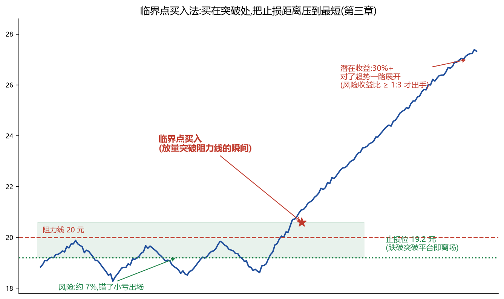
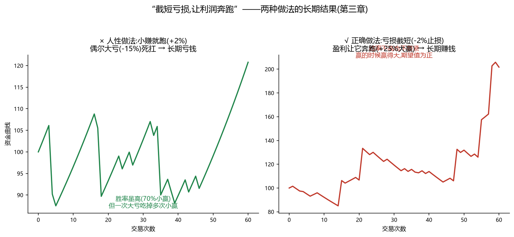
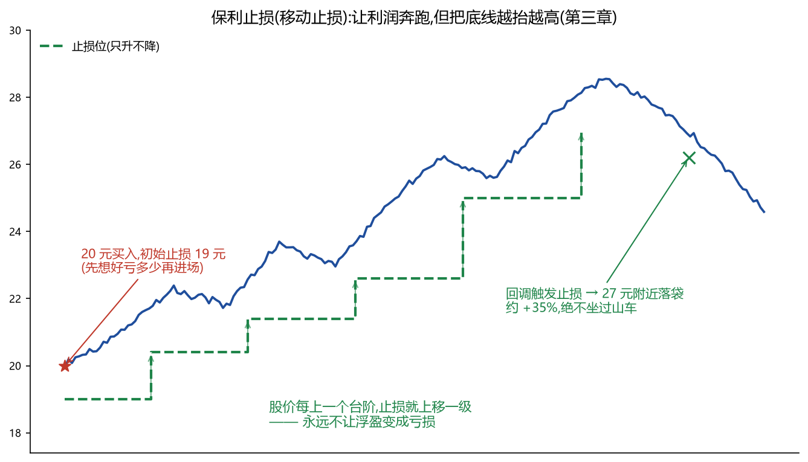

# 第三章 成功的要素(章节详解)

> **本章是全书的"操作手册":怎么买、怎么卖、怎么管钱、怎么训练自己。**
> 第二章给了你工具,这一章教你怎么用工具;第一章讲的人性弱点,会在这一章被逐一对付。

---

## 3.0 先立总纲:炒股成功的完整公式

```
成功 = 选对股(第二章基本分析)
     + 买对时(临界点买入)
     + 管对钱(资金管理)
     + 卖对时(止损与持有体系)
     + 熬得住(心态,见第一、四章)
```

任何一个环节缺失,结果都可能是零。**多数人把 100% 的精力放在"选对股"上,而恰恰在其他四项上一败涂地。**

---

## 3.1 何时买股票:临界点买入法(本章最核心的方法)

### 买入的四个前提(尽量同时满足)

1. **大市处于升势**:覆巢之下无完卵,大盘跌势中个股独走的概率很低;
2. **个股处于升势**:高点低点不断抬高(见第二章三种走势);
3. **股价处于关键突破位置**:刚向上突破阻力线/前高/创新高——即**临界点**;
4. **突破有成交量配合**:放量突破才可信(见第二章 2.2.6)。

### 什么是临界点?



股价突破阻力线的那个位置,就是临界点。它是多空力量的分水岭:

- **假突破** → 股价很快跌回阻力线下 → 你在临界点下方一点点设好止损 → **损失极小**;
- **真突破** → 阻力变支撑,趋势展开 → **收益极大**。

**所以临界点买入的本质是:把"离场点"和"入场点"的距离压到最短,让每一笔交易的潜在亏损很小、潜在收益很大。** 这就是风险收益比思维:至少 1:3 才出手——错了亏 1 块,对了赚 3 块,那么即使三次只对一次,长期依然赚钱。

> 对照第一章:人性喜欢买"便宜的、跌了很多的"股票(因为"怕高"),而临界点买入要求你买"创新高的、强的"股票——**这是反人性的,也是少数人赚钱的原因之一。**

### 为什么绝不抄底?

- "底"是走出来的,不是猜出来的。你以为是底,下面还有地下室;
- 抄底的本质是"逆势猜反转":即使猜对,你也说不清止损该放哪(没有明确的失败标准);
- 临界点买入则是"顺势确认":**等股票自己证明转强了再上车**,宁可少赚底部那段,也要买得踏实。

### 买前检查清单(照着念一遍再下单)

- [ ] 大盘是升势吗?
- [ ] 个股是升势吗?
- [ ] 买点在突破位置吗?突破放量了吗?
- [ ] 止损位定在哪?离买点远吗?(越近越好)
- [ ] 这次交易最多亏多少钱?占本金百分之几?(看 3.3 资金管理)
- [ ] 我能说出这笔交易的理由吗?(说不出来就是赌博)

**有任何一条过不了,就不买。等待,是炒股的一部分。**

---

## 3.2 何时卖股票:止损体系 + 让利润奔跑

作者反复强调:**卖比买难**。买错的痛苦是一次性的,卖错的纠结是持续性的。解决办法是**事先定好规则,触发就执行**,把决定权交给纪律而不是情绪。



上图是两种卖法的长期结果:左边"小赚就跑、大亏死扛",胜率看着很高,长期却稳定亏钱;右边"亏损截短、盈利拿住",胜率不高,资金曲线却持续向上。**炒股赚钱靠的不是胜率,而是"赢的时候赢多少、输的时候输多少"。**

### 卖出的四种情形(触发任何一条立即执行)

**① 硬止损:跌破买入前定好的止损位**

- 无条件卖。不找理由、不等反弹、不看消息;
- 止损位通常设在突破平台的下方(如临界点买在 20.6,止损设 19.2),这样假突破很快就能识别;
- 记住第一章的数学:亏损是不对称的,小亏永远可以挽回,大亏很难。

**② 保利止损(移动止损):涨了就把止损位往上提**



- 股价每上一个台阶,止损位就上移一级,**只升不降**;
- 关键节点:**一旦有浮盈,先把止损提到成本价之上**——从这一刻起,这笔交易最差也是平局,"别让利润变成亏损"(家训第 8 条);
- 之后止损一路跟着趋势走,直到某次回调触发它——**利润自动落袋,绝不坐过山车**。

**③ 趋势破坏:走势走坏了就卖**

- 有效跌破上升趋势线;
- 跌破关键支撑线 / 放量跌破颈线(头肩顶、双顶成立);
- 这些信号的共同点:**走势宣告你原来的买入逻辑失效了**。逻辑没了,仓就没该在。

**④ 大市转弱:大盘由牛转熊,减仓离场**

- 个股很难长期对抗大盘;
- 大盘跌破重要支撑/200 天线且反不起来,系统性风险来临时,现金是最好的股票。

### 卖出的两条心态纪律

1. **买对了就让利润奔跑**:不要赚 10% 就急着落袋。上升趋势没破坏就一直拿着——大赢才能覆盖小亏(见 3.1 风险收益比);
2. **卖错了不后悔、卖对了不炫耀**:按规则执行就是满分操作。**赚亏由概率决定,对错只看是否守纪。**

---

## 3.3 资金管理:注码决定生死(最容易被新手忽视的一章)

作者有个精彩的说法:炒股高手和赌场老板思考的是同一个问题——**在哪儿下注、下多少注**。选股决定"下注在哪",资金管理决定"下注多少",而**后者对长期结果的影响,往往大于前者**。

### 原则一:永远不满仓,分批进场

- 满仓 = 失去纠错能力。留有现金,错了有回旋,对了有钱加码;
- 分批买入本身就是"用走势验证判断":先小仓试错,走势对了再加。

### 原则二:单笔风险要小

- **任何一笔交易的最大亏损(买入价 − 止损价)× 股数,只占总资金的小比例**(常见实践:1%~2%,即所谓 2% 规则);
- 这样即使连续错五六次,也只是小伤,永远保留"再来一次"的资格;
- 反例:一次亏 30%,再想翻身要赚 43%,心态先崩了。

### 原则三:亏损时减注,盈利时才加码(金字塔式)

- **连亏时**:缩小注码,甚至停止交易休息一段——这既保护资金,也保护心态(对治第一章的"报复心理");
- **盈利时**:走势证明你对了,才逐步加仓,且**越加越少**(金字塔:底大顶小),让成本始终保持在低位;
- **绝不向下摊平**(家训第 7 条):亏损加码 = 错上加错,是用更大的注码去证明一个已被市场否定的判断。

### 原则四:算清风险收益比再下注

- 出手标准:可能赚 ≥ 3,最多亏 ≤ 1;
- 临界点买入天然满足这一条(止损近、空间大),这也是为什么它是"最佳买点";
- 赔率不划算的好公司,和赔率划算的普通机会,选后者——**价格决定回报,而非公司名气**。

> **资金管理的一句话总结:先保证"错了死不了",再谈"对了赚多少"。**

---

## 3.4 炒手的自我训练:从知道到做到

知识可以直接读来,能力只能练出来。作者给出的训练路径:

1. **用小钱练手**:学费可控,心态也相对从容,先把完整流程走熟;
2. **记交易日记**:每笔记录——为什么买、为什么卖、当时情绪如何、结果如何;
3. **定期复盘**:重点不是"这笔赚没赚",而是"**这笔有没有按规则做**"。赚了但违反规则 = 坏交易(下次会害死你);亏了但完全守规 = 好交易;
4. **把方法固定成自己的系统**:别人的方法照搬必失败——**每个人的性格、资金、时间都不一样,必须长出适合自己性格的打法**;
5. **接受必经的学费阶段**:从新手到稳定盈利,没有捷径,只有"亏小钱 → 复盘 → 改进"的循环。

---

## 3.5 一笔完整交易的标准流程(全章收束)

```
① 选股  基本面过关:盈利增长(有收入支撑)/ 新产品 / 回购
   ↓
② 等待  大盘升势 + 个股升势 + 股价临近阻力线(不满足就空仓)
   ↓
③ 计划  进场前写好:买入价、止损价、仓位大小、失败标准
   ↓
④ 买入  放量突破临界点时分批买入,留有余仓
   ↓
⑤ 持有  走势没坏就拿住;有浮盈后把止损提到成本上方
   ↓
⑥ 卖出  触发止损 / 跌破趋势线 / 头部形态 / 大盘转弱 → 立即执行
   ↓
⑦ 复盘  写日记:只评价"守没守纪律",不评价"赚没赚钱"
```

---

## 3.6 本章自测

1. 临界点买入为什么是"风险最小、收益最大"的买点?用假突破/真突破两种情况说明。
2. 为什么说"抄底"即使赚钱也是坏习惯?
3. 移动止损的第一步是什么?"别让利润变成亏损"怎么落实?
4. 卖出的四种情形分别是什么?
5. 2% 规则怎么计算?它保护的是什么?
6. 金字塔加码的规则是什么?为什么"越加越少"?为什么绝不向下摊平?
7. 复盘时评价交易好坏的标准是什么?为什么不是"赚没赚"?
8. 为什么"别人的方法照搬必失败"?

---

**下一章**:技术和纪律之外,还有最后一层——[第四章 炒股的智慧](04-第4章-炒股的智慧.md):心态修炼、大师经验与复利人生。

*导航:[全书知识点速读](全书知识点速读.md) | [← 上一章](02-第2章-股票分析的基本知识.md) | [下一章 →](04-第4章-炒股的智慧.md)*
