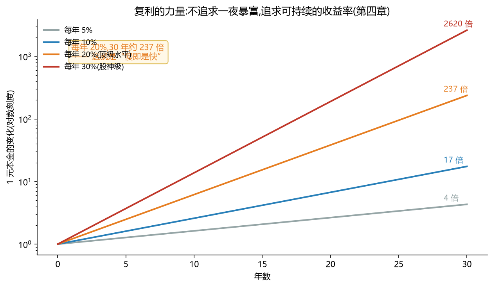

# 第四章 炒股的智慧(章节详解)

> **本章是全书的收束:技术之外,决定最终高度的是心态、时间和生活。**
> 前三章教你"怎么做",这一章回答"为什么你做不到,以及怎么办"。

---

## 4.1 炒股的智慧从哪里来:三样东西的循环

作者给出一个冷静的公式:

> **用钱换经验 → 用经验换钱 → 如此循环。**

围绕这个循环,有三样东西要积累:

| 要素 | 怎么获得 | 特点 |
|---|---|---|
| **知识** | 读书、学习 | 可以速成,但只解决"知不知道" |
| **经验** | 真金白银的实战 + 复盘 | 无法速成,解决"做不做得对" |
| **心态** | 在盈亏的反复锤打中修炼 | 最后的瓶颈,解决"守不守得住" |

三者的关系是递进的:**知识让你入门,经验让你入门后不死,心态让你最终稳定盈利。** 跳过任何一级,市场都会把你摁回去补课。

---

## 4.2 最后一道关:战胜自己

第一章讲过六大人性弱点,到这一章要正面回答:**怎么战胜?** 作者的态度是——战胜自己不是靠意志力硬扛,而是靠**把规则前置,让纪律代替临场决定**:

- **对付"贪"**:移动止损、金字塔加码这些规则,把"什么时候收手"变成机械动作,不给贪心发言的机会;
- **对付"怕"**:仓位管理(单笔风险小)让你"亏得起",亏得起才敢按信号买、按纪律拿;
- **对付"急"**:空仓等待的训练——一年抓住几次好机会,胜过全年无休地折腾;
- **对付"侥幸"**:止损纪律——止损点到了就执行,把"再等等"的空间彻底封死。

> 一句话:**炒股的最高境界,是把自己变成一套规则的执行者,而不是一个情绪的表演者。**

### 炒股成功的几个必备素质

1. **自信**:相信自己的研究和体系,不被涨跌和他人的话随意动摇;
2. **耐心**:好机会是等出来的;没有机会时,空仓就是最好的操作;
3. **胆识**:机会出现时敢于下注(仓位合理的前提下),机会消失时敢于离场;
4. **平常心**:把炒股当成一门生意,有成本(止损)、有收入(利润),不因单笔盈亏大喜大悲;
5. **纪律**:计划你的交易,交易你的计划。

---

## 4.3 大师们的智慧(作者引用的启发)

这些名字未必都在书中展开,但他们的思想与本书一脉相承,值得放在同一个框架里理解:

| 大师 | 核心思想 | 对应本书哪一章 |
|---|---|---|
| **巴菲特** | 保住本金;在别人贪婪时恐惧,在别人恐惧时贪婪;买自己看得懂的好公司并长期持有 | 第一章"保本第一";第一章反向情绪;第二章基本分析 |
| **彼得·林奇** | 投资你熟悉、能用常识判断的公司;宏观分析每年 15 分钟足矣 | 第二章小环境重于大环境 |
| **利弗莫尔** | 华尔街没有新鲜事(人性不变);截短亏损,让利润奔跑;大钱靠"坐得住",不靠频繁进出 | 第二章技术分析;第三章卖出体系;第三章"别频繁交易" |
| **索罗斯** | 先生存,再赚钱("先生存,后赚钱");认错要快,重要的不是对错,而是对时赚多少、错时亏多少 | 第一章保本;第三章风险收益比 |

> 共同点一目了然:**大师们谈的几乎都不是"预测",而是生存、纪律和人性。** 这正是本书全书的主线。

---

## 4.4 合理预期与复利:慢即是快

- 复利的数学是炒股世界最被低估的知识:**每年 20%,30 年约 237 倍;每年 30%,30 年超 2600 倍**;
- 所以**不需要**每年翻倍——追求暴利的人,通常在一次爆亏后连本带利还回去(见第一章"急功近利");
- 反过来,**把目标定为"每年稳定地不亏大钱 + 赚到合理利润"**,时间自会给出惊人的结果;
- 作者对新手的核心劝告:先追求"稳定的小赢",再让复利接管一切。**股市里活得久的人,最后都赚到了;跑得快的人,大多消失在半路。**

---

## 4.5 炒股与生活:账户之外还有人生

作者在书末回到一个朴素的主题:炒股是生活的一部分,**不是生活的全部**。

- **锻炼身体、保证睡眠**:交易需要清醒的头脑,疲惫时的人最容易犯大错(追高、扛单、报复性交易都发生在状态差的时候);
- **别让炒股绑架家庭和情绪**:账户的波动不应变成家人的噩梦;
- **平常心是最好的"技术"**:心态崩了,前面三章学的所有方法都会失灵;
- **亏了就当交学费,赚了别当自己是神**——市场永远会教育下一个自以为是的人。

---

## 4.6 全书总复习:一张表收束四句话

| 章节 | 核心命题 | 一句话带走 |
|---|---|---|
| 第一章 | 炒股是与人性的战斗 | 亏钱源于人性弱点:贪与怕;先学保本,再学赚钱 |
| 第二章 | 知识:基本面选股,技术面择时 | 盈利增长是股价之根;趋势、支撑阻力、量价是择时之眼 |
| 第三章 | 方法:临界点买入 + 纪律卖出 + 资金管理 | 买在突破处(止损近),亏小赚大,永不摊平 |
| 第四章 | 境界:战胜自己,慢即是快 | 用规则代替情绪,用复利代替暴利,用生活托底 |

**全书浓缩成一句话:**

> **在升势中,于放量突破阻力线处买入(临界点),进门前定好止损,错了小亏离场,对了让利润奔跑;用小仓位试错、用纪律活着、用耐心变富。**

---

## 4.7 终极自测(全书毕业考试)

1. 有人说"我现在亏了,等我回本就收手"——用全书至少三个知识点反驳他。
2. 完整描述一笔"标准好交易"的全过程(从选股到复盘,至少 6 个环节)。
3. 为什么说"炒股赚钱靠的不是胜率,而是盈亏比"?用 1:3 风险收益比举例计算。
4. 六大人性弱点各自对应哪条操作纪律?列表作答。
5. 每年 20% 的收益看起来"很慢",30 年后是多少倍?这改变了你对收益目标的看法吗?
6. 如果只能记住全书一句话,你记哪句?为什么?

---

## 附:本目录全部笔记导航

| 文件 | 内容 |
|---|---|
| [全书知识点速读](全书知识点速读.md) | 全书框架 20 分钟速读 |
| [第1章 炒股的挑战](01-第1章-炒股的挑战.md) | 人性弱点、特殊赌局、保本要诀 |
| [第2章 股票分析的基本知识](02-第2章-股票分析的基本知识.md) | 基本分析、技术分析、华尔街家训 |
| [第3章 成功的要素](03-第3章-成功的要素.md) | 临界点买入、卖出体系、资金管理、自我训练 |
| [第4章 炒股的智慧](04-第4章-炒股的智慧.md) | 心态修炼、大师智慧、复利与生活 |
| [阅读笔记](阅读笔记.md) | 原文摘录:投资心理 + 基本面分析 |
| [导致股价上涨的三因素](导致股价上涨的三因素.md) | 盈利增长 / 新产品 / 回购 专题 |
| [成本收益比率_PE_介绍](成本收益比率_PE_介绍.md) | PE、PEG 与估值陷阱 专题 |
| [images/gen_charts.py](images/gen_charts.py) | 全部配图的生成脚本,可自行修改重新生成 |

*整理依据:陈江挺《炒股的智慧》(第三版)。配图为学习示意,由 Python 脚本生成,非原书插图。*
